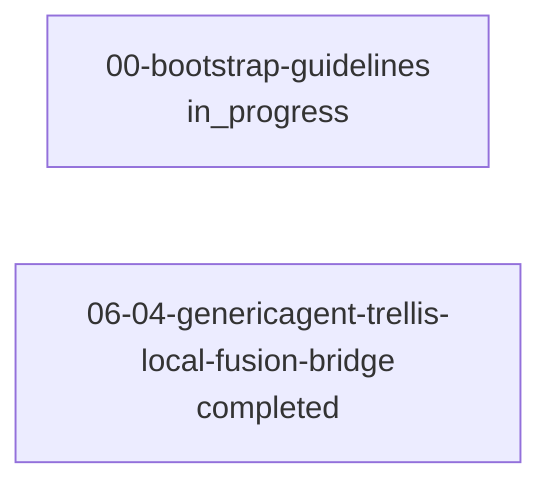

# L2 决策票据地图 · Trellis 视图（生成物，勿手改）

_生成 2026-10-04T15:58:58+08:00｜Trellis `.trellis`｜2 张票据｜可接活 0｜等前置 0_

> 权威 = `.trellis/scripts/task.py`（状态只能由它改）；本文件只读 Trellis 派生，过期自动 WARN。

## 现在能接的活

- （无）

## 全景

| 任务 | 状态 | 类型 | 标题 | 依赖 | 分支 | 证据 |
|---|---|---|---|---|---|---|
| 00-bootstrap-guidelines | in_progress | docs | Bootstrap Guidelines | - | task/00-bootstrap-guidelines | 0 |
| 06-04-genericagent-trellis-local-fusion-bridge | completed | - | genericagent trellis local fusion bridge | - | - | 3 |

## 证据索引（谁的结论靠什么）

- 06-04-genericagent-trellis-local-fusion-bridge: [file] tasks/archive/2026-06/06-04-genericagent-trellis-local-fusion-bridge/check.jsonl
- 06-04-genericagent-trellis-local-fusion-bridge: [file] tasks/archive/2026-06/06-04-genericagent-trellis-local-fusion-bridge/implement.jsonl
- 06-04-genericagent-trellis-local-fusion-bridge: [file] tasks/archive/2026-06/06-04-genericagent-trellis-local-fusion-bridge/research/ga-arch-hook-findings.md

